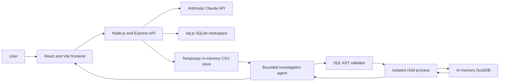

# AI SQL Assistant and CSV Data Investigation Agent

A full-stack portfolio project for learning how to build useful, bounded AI data tools. The application combines an existing natural-language SQL assistant with a separate CSV investigation mode powered by Claude and DuckDB.

The two modes share one React frontend and one Express backend:

- **SQL Assistant** turns natural-language questions into SQL, runs queries, explains SQL, fixes errors, and suggests optimizations.
- **Data Investigation** validates and profiles one uploaded CSV, shows deterministic visual summaries, and runs a bounded Claude tool-calling agent that can choose follow-up queries.

The investigation agent is designed to answer questions such as:

> Why did revenue fall in September?

It can inspect the dataset, ask for clarification, run several read-only queries, and return a report that separates observed patterns from causal explanations the CSV cannot prove.

## Current status

| Milestone | Status | Included work |
|---|---|---|
| 1. CSV upload and preview | Complete | Validation, type inference, missing values, distributions, outliers, deterministic visualizations, isolation, deletion, and expiry |
| 2. Safe query execution | Complete | AST validation, isolated DuckDB worker, read-only restrictions, and execution limits |
| 3. Investigation agent | Complete | Claude tool loop, clarification, adaptive queries, evidence IDs, causal limitations, and bounded execution |
| 4. Evidence and charts | Planned | Inspectable agent query results, numerical claim checks, and validated chart specifications |
| 5. Evaluation and documentation | Planned | Synthetic benchmark dataset, baseline comparison, measured accuracy, latency, and cost |

No accuracy, cost-saving, or performance-improvement claims have been measured yet. Those results will be added only after the evaluation harness is implemented.

## Main features

### SQL Assistant

- Generate SQL from normal-language questions using Claude.
- Use the active schema as model context.
- Execute SQL in the browser-facing query workspace.
- Explain, fix, and optimize SQL.
- Switch between SQLite, PostgreSQL, MySQL, and SQL Server generation dialects.
- Load CSV, SQLite, database, or SQL dump files into the SQL workspace.
- Use a Monaco SQL editor, result table, query history, and schema browser.

### Data Investigation

- Upload one UTF-8 CSV or reuse a CSV already selected in SQL Assistant.
- Inspect inferred types, missing values, unique values, date ranges, and sample rows.
- View charts for column types, missing values, numeric distributions, frequent categorical values, and IQR outlier candidates.
- Run manual read-only DuckDB queries against the table named `dataset`.
- Ask the investigation agent a business question in normal language.
- Answer a clarification question when a metric, date, period, or business definition is ambiguous.
- Receive a structured report with observations, evidence IDs, possible explanations, and limitations.

The preview visualizations are rendered locally with React and CSS. They do not make an LLM request and do not execute generated JavaScript or Python.

## Architecture



### Why there are two database engines

The original SQL Assistant uses **sql.js**, an in-process SQLite implementation. Keeping it avoids a large unrelated rewrite and preserves the existing SQL features.

Data Investigation uses **DuckDB** because it is well suited to analytical operations such as grouping, time comparisons, aggregates, and window functions. Investigation queries run in a separate child process so a slow or memory-heavy query can be terminated without taking down the main API process.

## Investigation request flow

1. The browser uploads a CSV with a random per-tab investigation session secret.
2. The backend validates the entire file before storing it temporarily in memory.
3. The browser sends a question and a short conversation history to the investigation endpoint.
4. Claude requests one of the three allowed tools.
5. Backend code validates the tool name and every argument. Claude never executes a tool directly.
6. A requested SQL query passes through the AST validator and the isolated DuckDB worker.
7. A bounded result is returned to Claude with a generated result ID.
8. Claude may select another query based on the observed result.
9. `finish_report` returns a validated structured report to the UI.

This is an actual tool-calling loop. It is not a fixed query sequence and is not a single text-to-SQL request.

## Agent tools

### `inspect_dataset`

Returns structural metadata and summary statistics:

- Row and column counts
- Column names and inferred types
- Missing and unique-value counts
- Numeric minimum, quartiles, median, mean, maximum, and outlier count
- Date ranges

Raw preview rows and categorical cell values are intentionally omitted from this tool result.

### `run_readonly_sql`

Accepts one SQL query and a short user-facing purpose. The query must:

- Be one parseable `SELECT` statement.
- Read the protected table named `dataset`.
- Reference no other physical table.
- Avoid writes, external readers, dynamic query functions, extensions, filesystem access, and network access.

### `finish_report`

Returns:

- A concise answer
- Observations supported by query result IDs
- Possible explanations supported by evidence
- A reason each possible explanation is not proven causal
- Limitations or missing information

The backend rejects evidence IDs that were not produced during the current investigation.

## Clarification and causal language

A request can be ambiguous even when the CSV is valid. For example, a dataset might contain both `gross_revenue` and `net_revenue`, or both `order_date` and `payment_date`.

The agent is instructed to ask one concise clarification question before querying when more than one definition is reasonable. Your answer is sent back with a bounded conversation history.

The final report separates:

- **Observed pattern:** “West-region revenue decreased by 20%.”
- **Possible explanation:** “The West-region decrease may have contributed to the total decline.”
- **Causal limitation:** “The CSV contains no experiment or external variables, so it cannot prove why the regional decrease occurred.”

## Safety boundaries and limits

Prompts are guidance. The security boundary is backend validation and process isolation.

### CSV limits

| Limit | Value |
|---|---:|
| File size | 2 MiB |
| Data rows | 10,000 |
| Columns | 50 |
| Total cells | 200,000 |
| Characters per field | 4,096 |
| Preview rows | 10 |
| Temporary retention | 30 minutes |
| Datasets held by one backend process | 10 |
| Concurrent uploads | 2 |

CSV files must contain a header, at least one data row, unique non-empty column names, consistent row lengths, valid quoting, and valid UTF-8.

### Query limits

| Limit | Value |
|---|---:|
| SQL statements | 1 |
| Allowed statement | `SELECT` only |
| Available table | `dataset` only |
| Query timeout | 5 seconds |
| DuckDB memory | 128 MB |
| Worker Node.js heap | 192 MB |
| Returned rows | 500 |
| Query output | 1 MB |
| Global concurrent queries | 2 |
| Concurrent queries per dataset | 1 |

DuckDB external access, automatic extension installation, extension loading, community extensions, and temporary disk usage are disabled inside the worker.

### Agent limits

| Limit | Value |
|---|---:|
| Total tool calls | 8 |
| Failed SQL retries | 2 after the initial attempt |
| Model turns | 10 |
| Total elapsed time | 45 seconds |
| Query rows visible to Claude | 40 |
| Query-result payload visible to Claude | 24 KB |
| Conversation history | 6 messages |
| Question length | 2,000 characters |

The model is asked to prefer aggregate queries. Query cells and column names are marked as untrusted data, and the application never treats instructions inside a CSV as permissions.

## Dataset lifecycle and isolation

- Investigation datasets stay in backend memory and are not written to disk.
- A random 64-character secret stored in browser `sessionStorage` identifies the browser tab's investigation session.
- The backend checks both the session secret and dataset ID on every investigation request.
- Uploading another investigation dataset for the same tab replaces the previous one.
- A dataset can be deleted immediately with **Delete dataset**.
- Expired datasets are removed automatically after 30 minutes.
- Reloading the frontend clears its current dataset selection, even if the backend copy has not expired yet.
- SQL Assistant uploads are temporary and a full page reload resets that workspace to the demo database.

The session secret provides lightweight isolation for this portfolio project. It is not user authentication.

## Technology stack

**Frontend**

- React 18
- Vite
- Monaco Editor
- Axios and Fetch API
- Lucide React
- react-hot-toast

**Backend**

- Node.js and Express
- Anthropic Claude SDK
- DuckDB Node Neo API
- sql.js / SQLite
- `node-sql-parser`
- `csv-parse`
- Multer
- Helmet
- express-rate-limit

**Testing**

- Node.js built-in test runner
- Deterministic mocked Claude responses for agent tests
- Real isolated DuckDB execution in query tests

## Project structure

```text
ai-sql-assistant/
|-- backend/
|   |-- routes/
|   |   |-- investigation.js        # CSV, query, delete, and agent endpoints
|   |   |-- sql.js                  # SQL generation and assistant endpoints
|   |   |-- upload.js               # Existing SQL workspace uploads
|   |   `-- health.js               # Server, API-key, and model status
|   |-- services/
|   |   |-- claudeService.js        # Claude provider integration
|   |   |-- datasetService.js       # CSV validation, profiling, and storage
|   |   |-- investigationAgentService.js # Bounded tool-calling loop
|   |   |-- investigationQueryService.js # Query worker lifecycle and limits
|   |   |-- queryValidator.js       # AST-based read-only SQL validation
|   |   `-- sqliteService.js        # Existing SQL Assistant database
|   |-- workers/
|   |   `-- duckdbQueryWorker.js    # Isolated in-memory DuckDB execution
|   |-- test/                       # Backend and agent tests
|   `-- server.js                   # Express entry point
|-- frontend/
|   `-- src/
|       |-- components/
|       |   |-- investigation/      # CSV preview, visuals, agent, SQL console
|       |   |-- editor/             # SQL Assistant workspace
|       |   `-- ui/                 # Navigation, sidebar, upload, theme
|       |-- context/                # React application state
|       `-- utils/api.js            # Frontend API client
|-- package.json                    # Root development scripts
`-- README.md
```

## Prerequisites

- Node.js 18 or newer
- npm
- An Anthropic API key for Claude-powered features

CSV profiling, preview charts, and manual read-only SQL do not require an LLM call. Natural-language SQL generation and the investigation agent do.

## Installation

```bash
git clone https://github.com/so123789/Text-to-SQL-Assistant.git ai-sql-assistant
cd ai-sql-assistant
npm run install:all
```

Create `backend/.env` from the example file.

PowerShell:

```powershell
Copy-Item backend/.env.example backend/.env
```

macOS or Linux:

```bash
cp backend/.env.example backend/.env
```

Set your API key and a Claude model available to your Anthropic account:

```env
PORT=5000
NODE_ENV=development
CLAUDE_API_KEY=your_key_here
CLAUDE_MODEL=claude-sonnet-4-5-20250929
RATE_LIMIT_WINDOW_MS=60000
RATE_LIMIT_MAX=30
UPLOAD_RATE_LIMIT_MAX=20
INVESTIGATION_AGENT_RATE_LIMIT_MAX=10
```

`ANTHROPIC_API_KEY` is also accepted when `CLAUDE_API_KEY` is not set. Keep `.env` out of version control. If a real key is exposed, rotate it in the Anthropic Console.

## Run the application

From the repository root:

```bash
npm run dev
```

This starts:

- Frontend: <http://localhost:5173>
- Backend: <http://localhost:5000>
- Health check: <http://localhost:5000/api/health>

The health response shows whether a Claude key was loaded and which model is active. It never returns the key itself.

### Run each service separately

Terminal 1:

```bash
cd backend
npm run dev
```

Terminal 2:

```bash
cd frontend
npm run dev
```

The backend uses Node's watch mode during development. Vite proxies frontend `/api` requests to port 5000.

### Production build

```bash
npm run build
npm start
```

The build command installs backend and frontend dependencies and creates the Vite production bundle. The Express server serves the built frontend when `NODE_ENV=production`.

## Use the SQL Assistant

1. Open <http://localhost:5173>.
2. Select **SQL Assistant** in the top navigation.
3. Use the built-in demo schema or upload CSV, SQLite, DB, or SQL files.
4. Enter a question such as `Show the top 5 customers by total order value`.
5. Generate SQL, review it in the editor, and run it.
6. Use **Explain**, **Fix**, or **Optimize** when needed.

Example demo questions:

- Show the top five customers by total order value.
- Which products have never been ordered?
- Calculate average order value by country.
- List completed orders with customer names.
- Show revenue by product category.

The SQL Assistant is a learning workspace and has different execution rules from Data Investigation. Review generated SQL before running it.

## Use Data Investigation

1. Select **Data Investigation** in the top navigation.
2. Upload a UTF-8 CSV. If a CSV was already selected in SQL Assistant, choose **Use this CSV**.
3. Review the inferred types, missing values, visual summaries, distributions, and outlier candidates.
4. Enter a question in the **Investigation agent** panel.
5. If the agent asks a clarification question, type the answer and continue.
6. Review the final observations, evidence IDs, possible explanations, and limitations.
7. Use the manual read-only query console to verify or explore the dataset yourself.
8. Select **Delete dataset** when finished.

Useful investigation questions:

- Why did revenue fall in September?
- Which region contributed most to the decline?
- Did lower order volume or lower average order value explain the change?
- Which products have the largest month-over-month decrease?
- Are missing values concentrated in a particular month or region?
- Which numeric columns contain potential outliers?

For best results, use clear column names such as `order_date`, `region`, `product`, `units`, and `revenue`. The agent will ask when several columns could represent the same business concept.

## Manual investigation SQL

The uploaded CSV is always available as the table `dataset`.

```sql
SELECT
  region,
  SUM(revenue) AS total_revenue
FROM dataset
GROUP BY region
ORDER BY total_revenue DESC;
```

Only a conservative PostgreSQL-compatible `SELECT` subset accepted by the AST parser can run. DuckDB may support syntax that the validator intentionally rejects.

## API endpoints

### SQL Assistant

| Method | Path | Purpose |
|---|---|---|
| `POST` | `/api/sql/generate` | Generate SQL from natural language |
| `POST` | `/api/sql/execute` | Execute SQL or generate and execute it |
| `POST` | `/api/sql/explain` | Explain SQL |
| `POST` | `/api/sql/fix` | Repair SQL using an error message |
| `POST` | `/api/sql/optimize` | Suggest optimizations and indexes |
| `GET` | `/api/schema/demo` | Return the active SQL workspace schema |
| `GET` | `/api/history` | Fetch query history |
| `DELETE` | `/api/history` | Clear query history |
| `DELETE` | `/api/history/:id` | Delete one history entry |
| `POST` | `/api/upload` | Load files into SQL Assistant |
| `POST` | `/api/upload/reset` | Reset SQL Assistant to demo data |
| `GET` | `/api/upload/status` | Return the active SQL data-source mode |

### Data Investigation

| Method | Path | Purpose |
|---|---|---|
| `POST` | `/api/investigation/datasets` | Validate and upload one CSV |
| `GET` | `/api/investigation/datasets/:id` | Return a dataset preview |
| `POST` | `/api/investigation/datasets/:id/query` | Run one safe read-only query |
| `POST` | `/api/investigation/datasets/:id/investigate` | Run the bounded Claude agent |
| `DELETE` | `/api/investigation/datasets/:id` | Delete the temporary dataset |
| `GET` | `/api/health` | Return server and model status |

Investigation routes require `X-Investigation-Session`, a random 64-character hexadecimal token. The frontend creates and sends it automatically.

## Tests and checks

Run backend tests:

```bash
cd backend
npm test
```

Build the frontend:

```bash
cd frontend
npm run build
```

The current backend suite contains 20 tests covering:

- CSV profiling, malformed data, encoding, and expiry
- Dataset ownership isolation and deletion
- SQL writes, multiple statements, external readers, and table restrictions
- Real isolated DuckDB execution and output truncation
- Adaptive agent follow-up queries
- Clarification before querying
- Invalid SQL retries and tool-call limits
- Fabricated evidence IDs
- Provider failures
- Malicious instructions stored in CSV cells

Agent tests use mocked Claude responses, so the test suite does not consume model API credits.

## Troubleshooting

| Problem | What to check |
|---|---|
| `EADDRINUSE: address already in use :::5000` | A backend is already running. Stop the old process or change `PORT` in `backend/.env`. |
| Claude key is missing | Add `CLAUDE_API_KEY` to `backend/.env` and restart the backend. |
| Claude rejects the key | Confirm the key is active and has access to the configured model. |
| Claude rejects a request | Check the backend console for the provider status, then confirm `CLAUDE_MODEL` is a valid Messages API model ID. |
| Dataset not found or expired | Upload the CSV again. Investigation datasets expire after 30 minutes. |
| CSV rejected as malformed | Check UTF-8 encoding, quoting, header names, row widths, and documented limits. |
| Investigation SQL rejected | Use one `SELECT` that reads only `dataset`; avoid external readers and DuckDB extension functions. |
| Investigation stops early | It may have reached the tool, retry, query, provider, or 45-second limit. Ask a narrower question. |
| UI changes do not appear | Restart Vite or perform a hard refresh with `Ctrl+Shift+R`. |
| Port 5173 is unavailable | Stop the process using that port or start Vite with another port and update backend CORS settings. |

## Current limitations

- There is no account authentication or durable multi-user storage. The session token is isolation, not identity.
- Investigation datasets exist only in one backend process and are unsuitable for horizontally scaled deployment.
- Reloading the UI loses the selected investigation dataset ID.
- The existing SQL Assistant is not protected by the investigation mode's strict AST-based read-only policy.
- Model output can still be incomplete or incorrect. Evidence IDs currently prove that a referenced query ran, but full numerical claim validation is planned for milestone 4.
- The agent does not yet create charts. Current preview charts are deterministic and do not depend on Claude.
- The SQL validator accepts a conservative query subset and may reject valid DuckDB SQL.
- A CSV can reveal correlations and contributing patterns, but it normally cannot establish causation.
- Model usage incurs Anthropic API costs. The application reports token usage internally, but reliable cost display and comparative cost evaluation are not implemented yet.
- Accuracy, latency, and cost have not been benchmarked against the single-query baseline yet.

## Resume-ready project bullets

- Built a bounded autonomous data investigation agent using Claude tool calling, Node.js, Express, React, DuckDB, and SQLite to answer multi-step questions over uploaded CSV files.
- Designed `inspect_dataset`, `run_readonly_sql`, and `finish_report` tools with server-side argument validation, adaptive follow-up queries, evidence tracking, clarification handling, and causal-claim limitations.
- Secured investigation SQL with AST parsing, isolated DuckDB workers, read-only enforcement, and limits on runtime, memory, concurrency, rows, and output size.
- Implemented CSV profiling and deterministic visualizations for missing data, inferred types, numeric distributions, categorical frequencies, and IQR-based outlier candidates.
- Added 20 automated tests covering adaptive investigations, malformed data, malicious CSV instructions, invalid SQL, fabricated evidence, provider failures, and execution limits.
